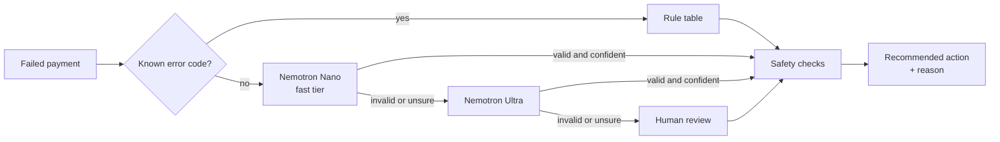

# AR3

**Know why a payment failed before you retry it.**

AR3 is an open-source decision layer for failed UPI and card payments. Known error codes are decided by a rule table. Messy, vague errors are diagnosed by NVIDIA Nemotron on Nebius Token Factory. Independent safety checks have the final say. AR3 recommends the next step with a reason; it never moves money.

[Live demo](https://ar3-payments.streamlit.app) · [Video](https://www.youtube.com/watch?v=apM7ogyRBzQ) · [Results](#results) · [How it decides](#how-ar3-decides) · [Run it](#run-it)

    

---

## Results

On 150 labelled failed payments (30 known codes, 120 messy errors; 55 UPI, 51 card, 14 netbanking among the messy ones), every policy saw the same cases:

| | Retry everything once | AR3, rules only | **AR3 with Nemotron** |
| --- | --- | --- | --- |
| Correct decisions, all cases | 33% | 31% | **98%** |
| Correct decisions, messy cases | 32% | 13% | **98%** |
| Unsafe actions (retrying fraud, dead cards, or past the cap) | 50 | 0 | **0** |
| Sent to a human | 0% | 80% | **11%** |

**What Nemotron adds:** on the 120 messy errors, rules alone can only hand 80% of cases to a human. With Nemotron, AR3 decides 98% of them correctly and still sends the genuinely unclear ones (like UPI U30 "debit failed") to review. Diagnosis accuracy on messy cases is 99%; always guessing the most common category would score 22%.

**Who decided:** rule table 20%, Nemotron Nano 69%, Nemotron Ultra 1%, no confident answer (sent to a human) 11%. Median time per messy case: 0.9 s.

**Nemotron tiers on the 120 messy cases** (same prompt, each tier alone):

| | Nano, reasoning off | Nano, reasoning on | Ultra, reasoning on |
| --- | --- | --- | --- |
| Diagnosis accuracy | 97% | 96% | 94% |
| Invalid replies | 0 | 0 | 0 |
| Median time | 1.0 s | 2.2 s | 1.7 s |
| Median tokens | 1,108 | 1,308 | 1,360 |

On this task the bigger model did not buy accuracy: the gap is within run-to-run noise, the prompt was developed through the fast tier, and sorting an error into six categories is classification, not deep reasoning. That is why AR3 uses Nano first and calls Ultra only when Nano is unsure.

Rerun every number above with one command: `python evaluate.py --tiers`

### How the score got there

Every step was found by measuring, not guessing. All runs are saved in `results/`.

| Run | Correct | Unsafe | What changed |
| --- | --- | --- | --- |
| 1 | 87% | 0 | Baseline prompt. All 20 errors were over-cautious stops: the model diagnosed correctly but didn't know which action each category gets. |
| 2 | 97% | 1 | Added the action table to the prompt, and "generic declines are too vague to call". One misdiagnosis slipped past a check that trusts the model's category. |
| 3 | **98%** | **0** | Added two safety checks that read the error text itself (risk words, dead-card words), so a wrong diagnosis can't cause a risky retry. |

These fixes were found on the same test set they are measured on, so this is not a held-out score. A fresh held-out set is the next step.

**The 3 cases AR3 still gets wrong** (all decided by Nemotron Nano):

| Code | Description | Expected | Got |
| --- | --- | --- | --- |
| RB_TIMEOUT | Remitter bank did not respond in time | Ask the customer | Retry through another acquirer |
| MANDATE_PAUSED | Customer has paused the AutoPay mandate | Stop | Retry later |
| ACCT_DORMANT | Remitter account is dormant | Ask the customer | Stop |

## The problem

When a UPI or card payment fails, gateways already retry. But many failures come back vague, like UPI's U30 "debit failed", and nobody knows *why*. Retrying blindly wastes money and annoys banks and customers. Giving up loses the sale.

**Who it's for:** Indian subscription businesses that collect through UPI AutoPay and cards, often across more than one gateway, and need a consistent, explainable answer to "what do we do with this failed payment?"

**Talking to the people who'd use it:** I reached out to 29 people, including 22 founders across 17 Indian fintech and consumer startups that collect payments (among them Juspay, Jar, Rupifi, Drona Pay, Fundly.ai, Credfix and topmate.io), plus employees at several of them. No replies to the question yet; their answers will shape v2.1.

## The finding that shaped AR3

Same failed payment (UPI U30, "debit failed"), same model (`nvidia/NVIDIA-Nemotron-3-Nano-30B-A3B`), temperature 0. Only reasoning was switched on or off:

| | Reasoning on | Reasoning off |
| --- | --- | --- |
| Diagnosis | GATEWAY_TEMPORARY | HARD_DECLINE |
| Confidence | 0.85 | 0.95 |
| Time | 14.0 s | 2.5 s |
| Tokens | 405 | 145 |

The faster answer was more confident and probably wrong: "debit failed" is too vague to call a permanent decline. A model's confidence is not evidence, so AR3 never lets the model decide alone. With AR3's prompt, the same payment now goes fast tier (unsure, 0.30) → Ultra (unsure, 0.35) → human review.

## How AR3 decides



1. **Rules first.** Known codes (insufficient funds, expired card, suspected fraud) are decided instantly, for free, and predictably. The model never sees them.
2. **Nemotron for the messy ones.** The fast tier answers first. Only an invalid answer or confidence below 0.7 escalates to Ultra, so the expensive model sees only the hard cases.
3. **Safety checks have the final say.** Every decision, from rules or the model, passes independent checks that can override it. Every override is recorded.
4. **A recommendation, never a payment.** The output is one of five actions with a reason. The merchant's system or gateway carries it out.

The five actions: retry through another acquirer, retry later, ask the customer, stop, or send to a human. There is deliberately no "switch the customer's payment method" action: a merchant can't do that silently.

## Which model does what

| Decided by | Model | Used when | Where |
| --- | --- | --- | --- |
| Rule table | none | Known error code | `rules.py` |
| Nemotron Nano | `nvidia/NVIDIA-Nemotron-3-Nano-30B-A3B`, reasoning off | Unknown code, first look | `llm.py` → `ask_nemotron()` |
| Nemotron Ultra | `nvidia/Nemotron-3-Ultra-550b-a55b`, reasoning on | Nano's answer invalid or below 0.7 | `llm.py` → `ask_nemotron()` |
| Fallback | none | Both tiers invalid or unsure | `llm.py` → `diagnose()` |

All model calls go through Nebius Token Factory's OpenAI-compatible API (`https://api.tokenfactory.nebius.com/v1/`). Model IDs and thresholds live in `config.py`.

## Safety checks

| Check | Prevents |
| --- | --- |
| Low confidence | Acting on an unsure answer → human review |
| Risk is never retried | Retrying or prompting on possible fraud → stop |
| Risk words in the error text | The same, even if the model misdiagnosed the category ("fraud", "compliance", "velocity"...) |
| Hard declines are never retried | Retrying a dead card → stop |
| Dead-card words in the error text | The same, even if the model misdiagnosed ("expired", "account closed", "not permitted"...) |
| Alternate acquirer only for gateway glitches at checkout | Instant retries where they can't help |
| Scheduled retries only for recurring payments | Making a waiting customer wait days |
| Prompt only when the customer is present | Prompting someone who isn't there |
| Retry cap | Retry loops (attempt 3 or later → stop) |
| Minimum wait | Hammering the bank (15 min; 30 min above ₹50,000) |

The checks are independent: every check runs on every decision, so two problems on one payment are both caught. Two layers on purpose: some checks trust the diagnosis, others read the raw error text, so one wrong diagnosis can't cause an unsafe retry. Retries also get an idempotency key (payment id + next attempt number) so a duplicated retry can't charge twice.

## Why the numbers are worth believing

- **Same cases for every policy.** Each column of the results table ran on the identical test set.
- **A baseline ladder, not a single score.** Retry-everything, rules-only and full AR3 show what each layer adds.
- **Unsafe actions are counted, not just accuracy.** A policy that recovers more by retrying fraud would show up here.
- **Failures are listed,** and so are the earlier, worse runs.
- **Reproducible.** `python evaluate.py --tiers` regenerates every number.

## What's real and what's simulated

| Real | Simulated |
| --- | --- |
| Public card and UPI error codes in the rule table | The failed payments in the test set |
| Live Nemotron calls through Nebius Token Factory | Acquirer names (placeholders) |
| The rules, safety checks and engine (45 tests) | |

## What AR3 does not claim

- It has not been run on real merchant data.
- It does not message customers or move money; it recommends.
- It is not a payment router. Routing tools decide where a payment goes; AR3 decides what to do after it fails, and when not to retry.

## Known limitations

- **Synthetic test data, not held out.** The test set was written by the author, and the prompt and keyword checks were improved using it. Results show the method works on realistic cases, not production accuracy.
- **Runs vary slightly.** Even at temperature 0, one or two cases can flip between runs.
- **Many merchants don't choose the acquirer.** On a single gateway, the gateway picks the acquirer, so "retry through another acquirer" is a recommendation to pass to the gateway or a payment orchestrator.
- **The model's confidence is self-reported.** AR3 escalates and checks it rather than trusting it; calibrating it against real outcomes is future work.

## How AR3 differs from existing tools

Parts of this problem are already handled well: Stripe returns decline and advice codes and offers Smart Retries; Razorpay Optimizer routes payments across gateways; Juspay's open-source Hyperswitch offers smart routing and auto-retries. AR3 is a different layer that works alongside them:

- **UPI-first diagnosis.** Vague codes with free-text errors are where Nemotron does real work.
- **Gateway-agnostic.** One consistent decision layer across several gateways.
- **Safety-first and explainable.** A reason on every decision, independent checks, human review when unsure.
- **Open-source and small.** Readable in an afternoon, easy to adapt.

## Run it

Requires Python 3.14.

```bash
git clone https://github.com/punar4/ar3.git
cd ar3
python -m venv venv
venv\Scripts\activate        # Windows
source venv/bin/activate     # Mac/Linux
pip install -r requirements.txt
```

Copy `.env.example` to `.env` and add your Nebius Token Factory API key. Then:

| Command | What it does |
| --- | --- |
| `python -m pytest` | Runs all 45 tests (no API key needed; the model is faked) |
| `python smoke_test.py` | Lists the Nemotron models and makes one live call |
| `python live_check.py` | Runs the full two-tier diagnosis on two real payments |
| `python make_testset.py` | Rebuilds the 150-case test set |
| `python evaluate.py --tiers` | Regenerates the results tables |
| `streamlit run app.py` | Starts the demo locally |

## Input format

One failed payment per row, as CSV or JSON (the demo's Batch tab has a template):

| Field | Required | Example |
| --- | --- | --- |
| `payment_id` | yes | `pay_001` |
| `amount_paise` | yes | `49900` (₹499.00) |
| `method` | yes | `UPI`, `CARD` or `NETBANKING` |
| `channel` | yes | `LIVE_CHECKOUT` or `RECURRING` |
| `error_code` | yes | `U30` |
| `error_description` | no | `debit failed` |
| `error_source`, `error_step`, `error_reason` | no | gateway webhook fields |
| `attempt_number` | no | `1` |
| `acquirer` | no | `ACQ_A` |

## Repo layout

| File | What it does |
| --- | --- |
| `schemas.py` | Data shapes for a failed payment and a decision, validated with Pydantic |
| `rules.py` | Rule table for known card and UPI codes |
| `llm.py` | Two-tier Nemotron diagnosis with safe fallback |
| `policy.py` | Independent safety checks |
| `engine.py` | The full flow: rules → Nemotron → safety checks |
| `config.py` | Model IDs, thresholds and limits |
| `make_testset.py` | Builds the 150 labelled test payments |
| `evaluate.py` | The evaluation behind the results tables |
| `app.py` | The Streamlit demo |
| `results/` | Evaluation output, including earlier runs |
| `tests/` | 45 tests |
| `FEEDBACK.md` | Feedback on Nebius Token Factory and Nemotron |
| `CHANGES.md` | Day-by-day build log |

## What's next

- A held-out test set, and real outcome data where available
- Measure how well Nemotron's confidence matches its accuracy, and set thresholds from data
- An API endpoint that accepts gateway "payment failed" webhooks
- An outage detector that pauses retries to a failing bank

## Built with

NVIDIA Nemotron on Nebius Token Factory · Python · Pydantic · Streamlit · pytest

## License

MIT