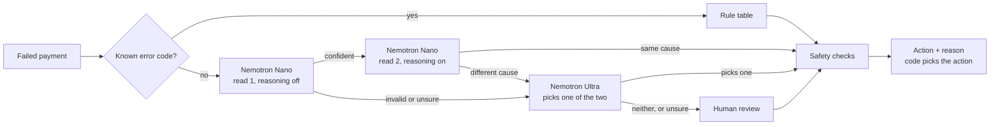

# AR3 for PayPal

**PayPal tells you what failed. AR3 decides what to do about it, safely, for merchants and for AI agents, and acts only after a person approves.**

AR3 is an open-source decision layer for failed payments. When a PayPal capture fails, it diagnoses why, picks one of five safe next steps with a reason, and, once a named person approves, carries it out through the PayPal Orders API with a `PayPal-Request-Id`, so a repeated retry can never charge twice. Known error codes go to a rule table. Unclear ones go to NVIDIA Nemotron on Nebius Token Factory, read twice. Independent safety checks have the final say.

[Live demo](<RENDER_URL>) · [Video](<VIDEO_URL>) · [PayPal results](#paypal-results) · [How it decides](#how-ar3-decides) · [Run it](#run-it) · [MCP tool](docs/mcp.md)

     

---

## AR3 for PayPal

### The problem

A failed PayPal capture comes back as an error like `INSTRUMENT_DECLINED`, `TRANSACTION_REFUSED` or a 500. PayPal reports what failed; the merchant, or more and more an AI shopping agent acting for a customer, still has to decide what to do next. Retry now? Ask the buyer to pick another way to pay? Never retry? Get it wrong and you either lose a sale that a safe retry would have saved, or you retry something you should not: a refused or suspected-fraud payment, an order that is already captured, or the same capture twice.

**Who it's for:** merchants on PayPal checkout and subscriptions, and builders of AI agents that pay on a customer's behalf and need a safe answer to "my payment failed, what now?"

### What happens in the demo (PayPal sandbox, live)

1. **Create** a real sandbox order (`POST /v2/checkout/orders`). Optionally approve it as the sandbox buyer.
2. **Fail** the capture on purpose with PayPal's negative testing (`PayPal-Mock-Response`): server error, declined instrument, refused transaction, already captured, buyer action required. Three further PayPal-style errors are simulated to show Nemotron's part.
3. **Decide.** AR3 diagnoses the failure and shows the action, the reason, who decided (rule table or Nemotron) and every safety check it passed.
4. **Approve and act.** Nothing happens until a named person approves. Then AR3 retries the capture with `PayPal-Request-Id: <order>:attempt-N`, or sends the buyer back to PayPal, or stops. Send the same retry again, and PayPal returns the same capture: **Captures on this order: 1**.

### PayPal APIs used, and where

| PayPal API | What AR3 uses it for | Where |
| --- | --- | --- |
| OAuth 2.0 client credentials (`/v1/oauth2/token`) | Access token, cached until it expires | `paypal_client.py` → `get_token()` |
| Create order (`POST /v2/checkout/orders`) | The sandbox order, with Pay Now and a return page | `paypal_client.py` → `create_order()` |
| Capture order (`POST /v2/checkout/orders/{id}/capture`) | The failing capture, and the approved retry | `paypal_client.py` → `capture_order()`; `actions.py` → `execute()` |
| Show order details (`GET /v2/checkout/orders/{id}`) | Order status, and counting captures after the retry | `paypal_client.py` → `get_order()` |
| `PayPal-Request-Id` header | Idempotent retries: the same key can't capture twice | `engine.py` (key), `actions.py` (sent) |
| `PayPal-Mock-Response` header | Real sandbox failures on demand (negative testing) | `paypal_client.py` → `_call()` |
| PayPal error responses (`name`, `issue`, `description`, `debug_id`) | Turned into AR3's input | `paypal_adapter.py` → `from_paypal_error()` |

### The AI part

- **Rules first.** 17 PayPal error codes are decided by the rule table, instantly and for free.
- **Nemotron for the rest.** Unknown or vague errors go to Nemotron Nano, read **twice** (reasoning off, then on). If the two reads agree on the cause, AR3 uses it. If they disagree, Nemotron Ultra must pick one of the two; if it can't, a person decides.
- **The model diagnoses, code decides.** The model names the cause and answers one question: could a later retry work without anyone acting? AR3's code turns that into the action. The model can't pick an action that contradicts the table.
- **Safety checks** can overrule any decision, and every override is shown.

Why read twice: a model's confidence is not evidence. In testing, Nemotron called a bare HTTP 403 "fraud" with 0.9 confidence. Agreement between two independent reads is a measured signal; self-reported confidence is not.

### For AI agents (MCP)

`ar3_mcp.py` runs AR3 as a Model Context Protocol server with one tool, `decide_failed_payment`. An agent calls it before retrying a failed payment and gets the decision plus one plain instruction, such as "Do not retry this payment." or "Retry once now with the same PayPal-Request-Id: ...". Setup: [docs/mcp.md](docs/mcp.md).

### PayPal results

31 PayPal failures that are **not** in the rule table. Labels were written before any model run. Two full runs:

| | Retry everything once | Rules only | **AR3 with Nemotron** |
| --- | --- | --- | --- |
| Correct decisions | 8 of 31 | 5 of 31 | **97% (run 1), 94% (run 2)** |
| Unsafe actions | 11 | 0 | **0 in both runs** |
| Sent to a person | 0% | 100% | 16% |

**How it got there, honestly.** The first held-out run scored 77-81%, with 0 unsafe. The misses showed two general weaknesses, not missing codes: the model's confidence was not a reliable signal, and it sometimes chose an action that contradicted its own diagnosis. The fixes were general design changes (the second read, and code choosing the action), not new rules or keywords: 90%, then 94%, then the numbers above. Because the set was viewed while fixing, treat these as after-the-fact numbers on a small set, not a fresh held-out score. Every run is saved in `results/`.

**The cost:** the second read makes each model case slower (median 3-5 s) and sends more cases to a person (16%).

### What's real and what's simulated (PayPal)

| Real | Simulated |
| --- | --- |
| PayPal sandbox orders, OAuth, captures and order lookups | Three of the eight demo failures (PayPal can't produce them on demand) |
| PayPal's own error responses via negative testing | The 31 eval cases are written by the author, PayPal-style |
| `PayPal-Request-Id` idempotency, checked by counting captures | Sandbox money, not real money |
| Live Nemotron calls on Nebius Token Factory | |

### Known limitations (PayPal)

- **Scheduled retries are recorded, not run.** "Retry later" produces a plan with a time; there is no background job that fires it.
- **Small, author-written eval.** 31 PayPal cases; the fixes were general but the set was viewed. 1-2 cases still get the wrong action.
- **Sandbox only.** Not run on live PayPal traffic or real merchant data.
- **USD to INR is approximate** (a fixed rate) where AR3's rupee thresholds apply.
- **Approval is a typed name**, not real authentication.

### What changed since Oct 1

AR3 began in October 2026 as a UPI and card decision engine (Razorpay AI Buildathon, then the Nebius × NVIDIA hackathon; that version stays on `main`). New for this hackathon, on the `paypal` branch:

- PayPal Orders API v2 integration: sandbox orders, captures, negative testing, return page
- Human-approved actions: AR3 can now act, but only after a named person approves (`actions.py`)
- Idempotent retries with `PayPal-Request-Id`, shown live by counting captures
- PayPal error codes in the rule table, and a PayPal adapter
- The second read, and "the model diagnoses, code decides"
- A 31-case held-out PayPal evaluation (`paypal_eval.py`)
- AI-agent access through MCP (`ar3_mcp.py`)
- An AG Grid recovery queue in the Batch tab; hosting on Render
- Tests: 45 → 74

---

# The engine underneath (UPI and card)

The sections below describe the decision engine on the 150-case UPI and card set it was built on. Numbers are from the latest run (Nov 12, 2026, with the second read).

## Results

On 150 labelled failed payments (30 known codes, 120 messy errors; 55 UPI, 51 card, 14 netbanking among the messy ones), every policy saw the same cases:

| | Retry everything once | AR3, rules only | **AR3 with Nemotron** |
| --- | --- | --- | --- |
| Correct decisions, all cases | 33% | 31% | **99%** |
| Correct decisions, messy cases | 32% | 13% | **98%** |
| Unsafe actions (retrying fraud, dead cards, or past the cap) | 50 | 0 | **0** |
| Sent to a human | 0% | 80% | **11%** |

**What Nemotron adds:** on the 120 messy errors, rules alone can only hand 80% of cases to a human. With Nemotron, AR3 decides 98% of them correctly and still sends the genuinely unclear ones (like UPI U30 "debit failed") to review. Diagnosis accuracy on messy cases is 97%; always guessing the most common category would score 22%.

**Who decided:** rule table 20%, Nemotron Nano 65%, Nemotron Ultra 3%, no confident answer (sent to a human) 11%. Median time per messy case: 3.6 s (each model case is read twice).

**Nemotron tiers on the 120 messy cases** (October, one read per tier, same prompt):

| | Nano, reasoning off | Nano, reasoning on | Ultra, reasoning on |
| --- | --- | --- | --- |
| Diagnosis accuracy | 97% | 96% | 94% |
| Invalid replies | 0 | 0 | 0 |
| Median time | 1.0 s | 2.2 s | 1.7 s |
| Median tokens | 1,108 | 1,308 | 1,360 |

On this task the bigger model did not buy accuracy: the gap is within run-to-run noise, the prompt was developed through the fast tier, and sorting an error into six categories is classification, not deep reasoning. That is why AR3 uses Nano first and calls Ultra only when Nano is unsure.

Rerun every number above with one command: `python evaluate.py --tiers`

### How the score got there

Every step was found by measuring, not guessing. All runs are saved in `results/`.

| Run | Correct | Unsafe | What changed |
| --- | --- | --- | --- |
| 1 | 87% | 0 | Baseline prompt. All 20 errors were over-cautious stops: the model diagnosed correctly but didn't know which action each category gets. |
| 2 | 97% | 1 | Added the action table to the prompt, and "generic declines are too vague to call". One misdiagnosis slipped past a check that trusts the model's category. |
| 3 | 98% | 0 | Added two safety checks that read the error text itself (risk words, dead-card words), so a wrong diagnosis can't cause a risky retry. Submitted to Nebius × NVIDIA. |
| 4 | 95% | 0 | Nov 12: the second read, and code choosing the action from the model's diagnosis. Seven recurring low-balance and limit cases were stopped instead of retried later. |
| 5 | **99%** | **0** | The model now answers "could a later retry work without anyone acting?" instead of "must the customer act?". |

These fixes were found on the same test set they are measured on, so this is not a held-out score. A fresh held-out set is the next step.

**The 2 cases AR3 still gets wrong** (both safe misses):

| Code | Description | Expected | Got |
| --- | --- | --- | --- |
| DAILY_LIMIT | Payer has exceeded daily UPI transaction limit | Retry later | Stop |
| AML_HOLD | Transaction held for compliance review | Stop | Send to a person |

## The problem

When a UPI or card payment fails, gateways already retry. But many failures come back vague, like UPI's U30 "debit failed", and nobody knows *why*. Retrying blindly wastes money and annoys banks and customers. Giving up loses the sale.

**Who it's for:** Indian subscription businesses that collect through UPI AutoPay and cards, often across more than one gateway, and need a consistent, explainable answer to "what do we do with this failed payment?"

**Talking to the people who'd use it:** I reached out to 29 people, including 22 founders across 17 Indian fintech and consumer startups that collect payments (among them Juspay, Jar, Rupifi, Drona Pay, Fundly.ai, Credfix and topmate.io), plus employees at several of them. No replies to the question yet; their answers will shape v2.1.

## The finding that shaped AR3

Same failed payment (UPI U30, "debit failed"), same model (`nvidia/NVIDIA-Nemotron-3-Nano-30B-A3B`), temperature 0. Only reasoning was switched on or off:

| | Reasoning on | Reasoning off |
| --- | --- | --- |
| Diagnosis | GATEWAY_TEMPORARY | HARD_DECLINE |
| Confidence | 0.85 | 0.95 |
| Time | 14.0 s | 2.5 s |
| Tokens | 405 | 145 |

The faster answer was more confident and probably wrong: "debit failed" is too vague to call a permanent decline. A model's confidence is not evidence, so AR3 never lets the model decide alone. With AR3's prompt, the same payment now goes fast tier (unsure, 0.30) → Ultra (unsure, 0.35) → human review.

## How AR3 decides



1. **Rules first.** Known codes (insufficient funds, expired card, suspected fraud) are decided instantly, for free, and predictably. The model never sees them.
2. **Nemotron for the messy ones.** Nano reads the error twice, reasoning off then on. If both reads name the same cause, AR3 uses it. If they disagree, or Nano is invalid or below 0.7 confidence, Ultra decides between the candidates; if it can't, a person does. The model names the cause; AR3's code picks the action from a fixed table.
3. **Safety checks have the final say.** Every decision, from rules or the model, passes independent checks that can override it. Every override is recorded.
4. **Recommend first, act only with approval.** The output is one of five actions with a reason. For PayPal, AR3 can carry it out, but only after a named person approves.

The five actions: retry through another acquirer, retry later, ask the customer, stop, or send to a human. There is deliberately no "switch the customer's payment method" action: a merchant can't do that silently.

## Which model does what

| Decided by | Model | Used when | Where |
| --- | --- | --- | --- |
| Rule table | none | Known error code | `rules.py` |
| Nemotron Nano | `nvidia/NVIDIA-Nemotron-3-Nano-30B-A3B`, read twice (reasoning off, then on) | Unknown code | `llm.py` → `diagnose()` |
| Nemotron Ultra | `nvidia/Nemotron-3-Ultra-550b-a55b`, reasoning on | Nano's two reads disagree, or Nano is invalid or below 0.7 | `llm.py` → `diagnose()` |
| Fallback | none | Both tiers invalid or unsure | `llm.py` → `diagnose()` |

All model calls go through Nebius Token Factory's OpenAI-compatible API (`https://api.tokenfactory.nebius.com/v1/`). Model IDs and thresholds live in `config.py`.

## Safety checks

| Check | Prevents |
| --- | --- |
| Low confidence | Acting on an unsure answer → human review |
| Risk is never retried | Retrying or prompting on possible fraud → stop |
| Risk words in the error text | The same, even if the model misdiagnosed the category ("fraud", "compliance", "velocity"...) |
| Hard declines are never retried | Retrying a dead card → stop |
| Dead-card words in the error text | The same, even if the model misdiagnosed ("expired", "account closed", "not permitted"...) |
| Alternate acquirer only for gateway glitches at checkout | Instant retries where they can't help |
| Scheduled retries only for recurring payments | Making a waiting customer wait days |
| Prompt only when the customer is present | Prompting someone who isn't there |
| Retry cap | Retry loops (attempt 3 or later → stop) |
| Minimum wait | Hammering the bank (15 min; 30 min above ₹50,000) |

The checks are independent: every check runs on every decision, so two problems on one payment are both caught. Two layers on purpose: some checks trust the diagnosis, others read the raw error text, so one wrong diagnosis can't cause an unsafe retry. Retries also get an idempotency key (payment id + next attempt number) so a duplicated retry can't charge twice.

## Why the numbers are worth believing

- **Same cases for every policy.** Each column of the results table ran on the identical test set.
- **A baseline ladder, not a single score.** Retry-everything, rules-only and full AR3 show what each layer adds.
- **Unsafe actions are counted, not just accuracy.** A policy that recovers more by retrying fraud would show up here.
- **Failures are listed,** and so are the earlier, worse runs.
- **Reproducible.** `python evaluate.py --tiers` regenerates every number.

## What's real and what's simulated

| Real | Simulated |
| --- | --- |
| Public card and UPI error codes in the rule table | The failed payments in the test set |
| Live Nemotron calls through Nebius Token Factory | Acquirer names (placeholders) |
| The rules, safety checks and engine (74 tests) | |

## What AR3 does not claim

- It has not been run on real merchant data.
- It does not message customers. It moves money only in the PayPal sandbox, and only after a named person approves.
- It is not a payment router. Routing tools decide where a payment goes; AR3 decides what to do after it fails, and when not to retry.

## Known limitations

- **Synthetic test data, not held out.** The test set was written by the author, and the prompt and keyword checks were improved using it. Results show the method works on realistic cases, not production accuracy.
- **Runs vary slightly.** Even at temperature 0, one or two cases can flip between runs.
- **Many merchants don't choose the acquirer.** On a single gateway, the gateway picks the acquirer, so "retry through another acquirer" is a recommendation to pass to the gateway or a payment orchestrator.
- **The model's confidence is self-reported.** AR3 escalates and checks it rather than trusting it; calibrating it against real outcomes is future work.

## How AR3 differs from existing tools

Parts of this problem are already handled well: Stripe returns decline and advice codes and offers Smart Retries; Razorpay Optimizer routes payments across gateways; Juspay's open-source Hyperswitch offers smart routing and auto-retries. AR3 is a different layer that works alongside them:

- **UPI-first diagnosis.** Vague codes with free-text errors are where Nemotron does real work.
- **Gateway-agnostic.** One consistent decision layer across several gateways.
- **Safety-first and explainable.** A reason on every decision, independent checks, human review when unsure.
- **Open-source and small.** Readable in an afternoon, easy to adapt.

## Run it

Requires Python 3.12 or later.

```bash
git clone https://github.com/punar4/ar3.git
cd ar3
python -m venv venv
venv\Scripts\activate        # Windows
source venv/bin/activate     # Mac/Linux
pip install -r requirements.txt
```

Copy `.env.example` to `.env` and add your Nebius Token Factory API key. For the PayPal tab, also add `PAYPAL_CLIENT_ID` and `PAYPAL_CLIENT_SECRET` from a PayPal **sandbox** app (developer.paypal.com → Apps & Credentials, Sandbox). To approve orders as a buyer, create a US sandbox personal account under Testing tools → Sandbox accounts. Then:

| Command | What it does |
| --- | --- |
| `python -m pytest` | Runs all 74 tests (no API keys needed; the model and PayPal are faked) |
| `python paypal_check.py` | Creates a sandbox order and forces seven real PayPal failures |
| `python paypal_flow.py` | The full PayPal story: fail, decide, approve, retry twice, one capture |
| `python paypal_eval.py --runs 2` | The 31-case held-out PayPal evaluation |
| `python ar3_mcp.py` | Starts AR3 as an MCP server (see docs/mcp.md) |
| `python smoke_test.py` | Lists the Nemotron models and makes one live call |
| `python live_check.py` | Runs the full two-tier diagnosis on two real payments |
| `python make_testset.py` | Rebuilds the 150-case test set |
| `python evaluate.py --tiers` | Regenerates the results tables |
| `python -m streamlit run app.py` | Starts the demo locally |

## Input format

One failed payment per row, as CSV or JSON (the demo's Batch tab has a template):

| Field | Required | Example |
| --- | --- | --- |
| `payment_id` | yes | `pay_001` |
| `amount_paise` | yes | `49900` (₹499.00) |
| `method` | yes | `UPI`, `CARD`, `NETBANKING` or `PAYPAL` |
| `channel` | yes | `LIVE_CHECKOUT` or `RECURRING` |
| `error_code` | yes | `U30` |
| `error_description` | no | `debit failed` |
| `error_source`, `error_step`, `error_reason` | no | gateway webhook fields |
| `attempt_number` | no | `1` |
| `acquirer` | no | `ACQ_A` |

## Repo layout

| File | What it does |
| --- | --- |
| `schemas.py` | Data shapes for a failed payment and a decision, validated with Pydantic |
| `rules.py` | Rule table for known card, UPI and PayPal codes |
| `llm.py` | Nemotron diagnosis: two reads, Ultra as tie-breaker, safe fallback |
| `paypal_client.py` | PayPal Orders API v2 client (sandbox) |
| `paypal_adapter.py` | Turns a PayPal error into AR3's input |
| `actions.py` | Plans an action; carries it out only with a named approver |
| `ar3_mcp.py` | AR3 as an MCP tool for AI agents |
| `paypal_eval.py` | The held-out PayPal evaluation |
| `policy.py` | Independent safety checks |
| `engine.py` | The full flow: rules → Nemotron → safety checks |
| `config.py` | Model IDs, thresholds and limits |
| `make_testset.py` | Builds the 150 labelled test payments |
| `evaluate.py` | The evaluation behind the results tables |
| `app.py` | The Streamlit demo (PayPal, one payment, batch queue, evaluation) |
| `results/` | Evaluation output, including earlier runs |
| `tests/` | 74 tests |
| `FEEDBACK.md` | Feedback on Nebius Token Factory and Nemotron |
| `CHANGES.md` | Day-by-day build log |

## What's next

- A held-out test set, and real outcome data where available
- Measure how well Nemotron's confidence matches its accuracy, and set thresholds from data
- An API endpoint that accepts gateway "payment failed" webhooks
- An outage detector that pauses retries to a failing bank

## Built with

PayPal Orders API v2 (sandbox) · NVIDIA Nemotron on Nebius Token Factory · Python · Pydantic · Streamlit · AG Grid (streamlit-aggrid) · MCP (Python SDK) · Render · httpx · pytest

## License

MIT